# Relatório Técnico - Aula Prática 05

## 1. Identificação
- Título da prática: Acesso Remoto SSH via Redirecionamento de Portas no VirtualBox e Diagnóstico de Rede
- Aluno: João Pedro de Castro Laranjeira Rocha
- Matrícula: 2023007098
- Turma: LSOR - BSI
- Data da prática: 30/09/2026

## 2. Objetivo
Configurar o acesso remoto seguro via SSH à máquina virtual Ubuntu Server operando em modo NAT no VirtualBox, utilizando uma regra de Redirecionamento de Portas (Port Forwarding) da porta `5222` do Host para a porta `22` do Guest. Além disso, realizar o diagnóstico de rede no Linux (interfaces, rotas, rastreamento de pacotes e sessões ativas) e acompanhar, no Windows, o estado da porta redirecionada com `netstat -an` antes, depois e durante a conexão SSH.

## 3. Ambiente
- Host: Windows 11 com PowerShell 7.6.6
- Hipervisor: Oracle VirtualBox
- Guest: Ubuntu Server 26.04.1 LTS (kernel `7.0.0-30-generic`), VM `LSOR V2`, hostname `ubuntuserver`
- Usuário administrativo utilizado: `administrador`
- Adaptador 1 da VM: modo NAT
- Interface de rede no Guest: `enp0s3`, com IP `10.0.2.15/24` obtido via DHCP e MAC `08:00:27:65:aa:80`
- Gateway padrão (roteador virtual do VirtualBox): `10.0.2.2`
- Serviço de acesso remoto: `openssh-server`, instalado junto com o sistema na Aula 1
- Regra de redirecionamento criada:

| Nome | Protocolo | IP do Hospedeiro | Porta do Hospedeiro | IP do Convidado | Porta do Convidado |
| :--- | :---: | :---: | :---: | :---: | :---: |
| SSH | TCP | `127.0.0.1` | `5222` | `10.0.2.15` | `22` |

## 4. Procedimento
1. Na VM, foi executado `netplan status` para ler o estado atual da rede sem alterar nenhum arquivo. A interface `enp0s3` apareceu em estado `UP`, gerenciada pelo `networkd`, com o IP dinâmico `10.0.2.15/24` atribuído por DHCP e a rota padrão via `10.0.2.2`.
2. O índice de repositórios foi atualizado com `sudo apt update`, e os pacotes de diagnóstico foram instalados com `sudo apt install -y net-tools traceroute`.
3. Com o `net-tools` instalado, foi executado `ifconfig`, que exibiu o IP `10.0.2.15`, a máscara `255.255.255.0`, o MAC `08:00:27:65:aa:80` da interface `enp0s3` e o endereço de loopback `127.0.0.1` da interface `lo`.
4. A tabela de roteamento do kernel foi inspecionada com `route -n`. A linha de destino `0.0.0.0` apontou o gateway padrão `10.0.2.2` pela interface `enp0s3`.
5. Foi executado `traceroute 8.8.8.8` para rastrear o caminho dos pacotes até o DNS público do Google.
6. Foi executado o comando `w` no console da VM, que mostrou apenas uma sessão, no terminal local `tty1`.
7. No PowerShell do Windows, foi executado `netstat -an | findstr 5222` **antes** de criar a regra. Nenhuma linha foi retornada, pois nenhum processo escutava na porta `5222`.
8. No VirtualBox, em **Configurações > Rede > Adaptador 1 (NAT) > Avançado > Redirecionamento de Portas**, foi criada a regra `SSH`, que encaminha as conexões TCP de `127.0.0.1:5222` no Host para `10.0.2.15:22` no Guest.
9. Com a regra ativa, `netstat -an | findstr 5222` foi executado novamente, e a porta `5222` apareceu em estado `LISTENING`.
10. A conexão remota foi feita com `ssh -p 5222 administrador@127.0.0.1`. Depois da senha, o login foi aceito e exibiu a tela de boas-vindas do Ubuntu 26.04.1 LTS.
11. Com a sessão SSH aberta, foi executado `netstat -an | findstr 5222` em uma segunda aba do PowerShell, que exibiu as conexões em estado `ESTABLISHED`.
12. Dentro da sessão SSH, foi executado o comando `w`, que passou a listar duas sessões: a do console local (`tty1`) e a remota (`pts/0`).

### Comandos principais utilizados
*   **`netplan status`:** exibe o estado das interfaces, endereços, DNS e rotas gerenciados pelo Netplan.
*   **`apt install`:** instala pacotes a partir dos repositórios; usado para instalar `net-tools` e `traceroute`.
*   **`ifconfig`:** exibe as interfaces de rede com IP, máscara, MAC e estatísticas de tráfego.
*   **`route -n`:** mostra a tabela de roteamento do kernel em formato numérico, sem resolver nomes por DNS.
*   **`traceroute`:** lista os saltos (roteadores) percorridos pelos pacotes até o destino.
*   **`w`:** mostra os usuários conectados, o terminal de cada um (`tty` local ou `pts` remoto) e a origem da conexão.
*   **`netstat -an`:** lista as conexões e as portas TCP/UDP em escuta no Windows; com `findstr 5222`, a saída é filtrada para a porta redirecionada.
*   **`ssh -p`:** abre uma sessão remota criptografada em uma porta específica.

## 5. Testes e Evidências

**Print 1 - Estado da rede com netplan status: enp0s3 com IP 10.0.2.15/24 via DHCP e rota padrão via 10.0.2.2**

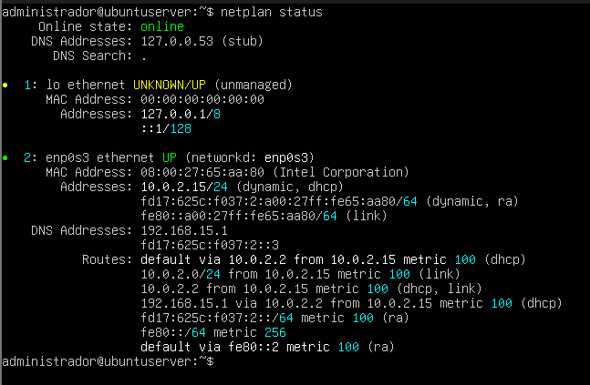

**Print 2 - Instalação dos pacotes net-tools e traceroute com apt**

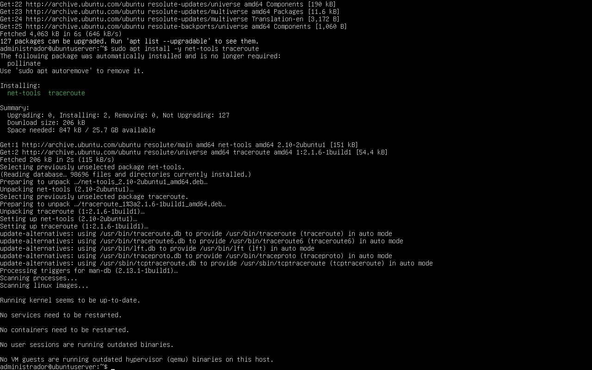

**Print 3 - Saída do ifconfig com o IP 10.0.2.15, máscara 255.255.255.0 e MAC 08:00:27:65:aa:80**

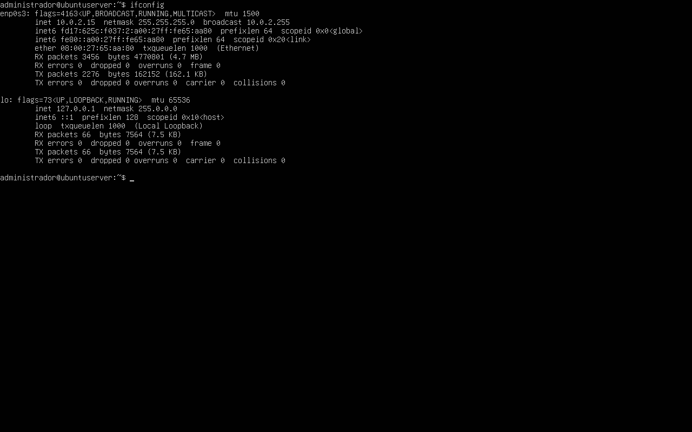

**Print 4 - Tabela de roteamento com route -n e gateway padrão 10.0.2.2**

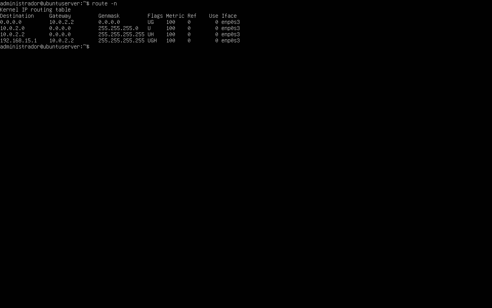

**Print 5 - Saída do traceroute 8.8.8.8**

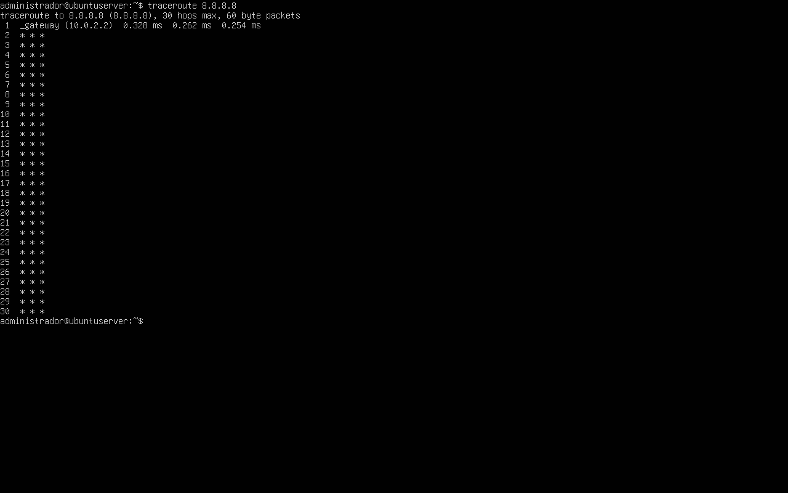

**Print 6 - Comando w no console da VM, com apenas a sessão local tty1**

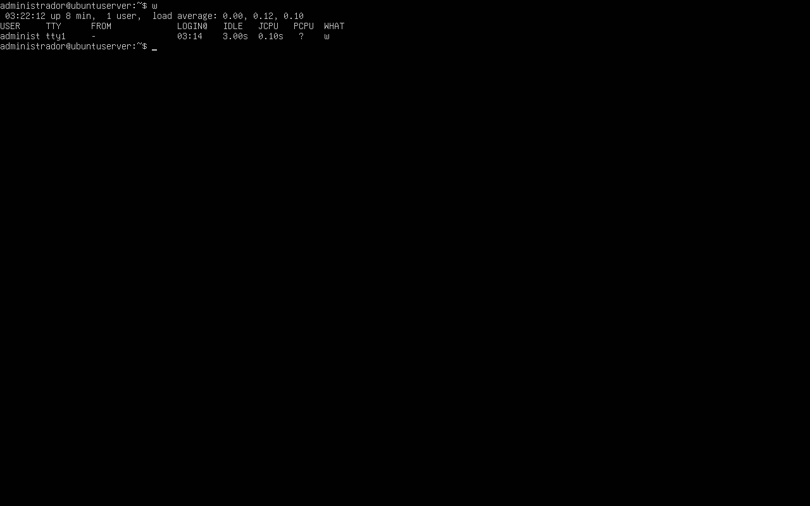

**Print 7 - netstat -an | findstr 5222 no Windows ANTES do redirecionamento, sem nenhuma linha retornada**

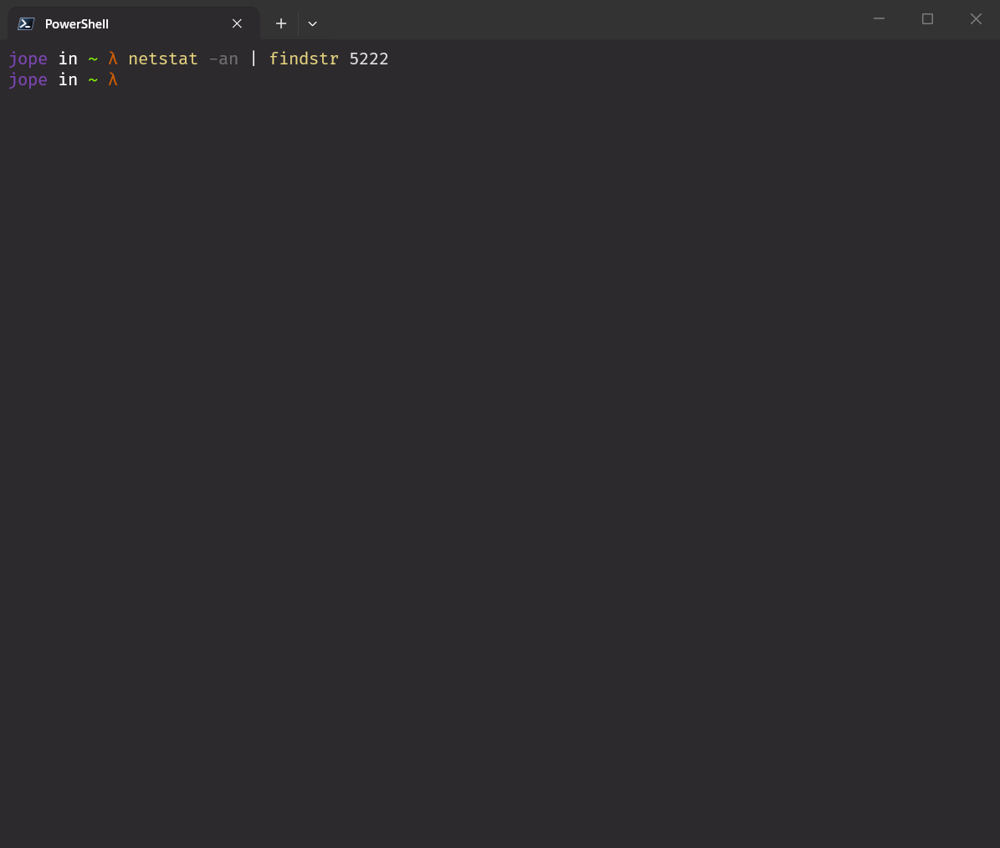

**Print 8 - Regra de redirecionamento SSH criada no VirtualBox (127.0.0.1:5222 -> 10.0.2.15:22)**

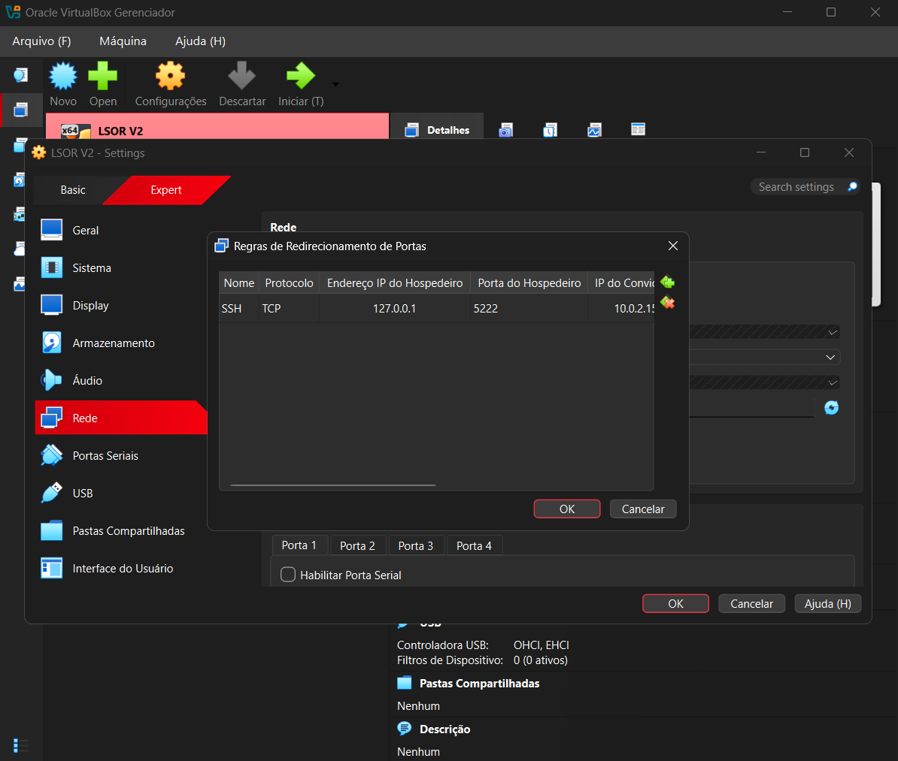

**Print 9 - netstat -an | findstr 5222 DEPOIS da regra, com a porta em LISTENING, e login via ssh -p 5222 administrador@127.0.0.1**

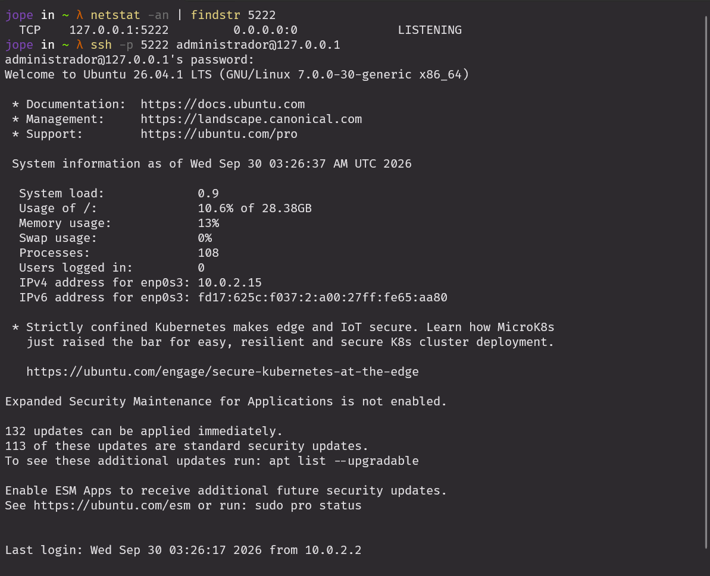

**Print 10 - netstat -an | findstr 5222 DURANTE a sessão SSH, com as conexões em ESTABLISHED**

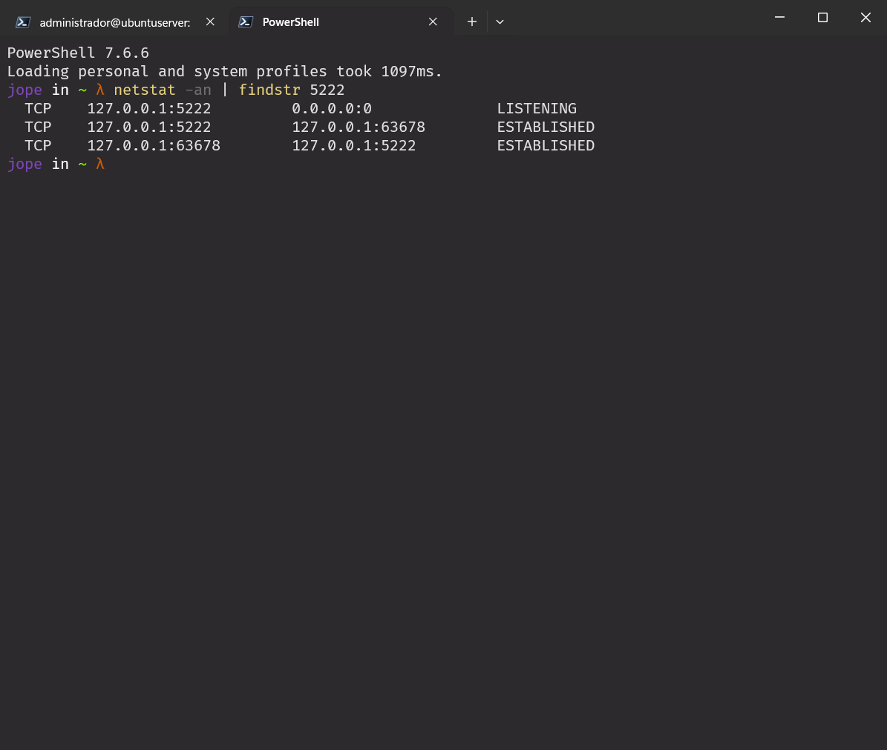

**Print 11 - Comando w dentro da sessão SSH, com o terminal remoto pts/0 vindo de 10.0.2.2**

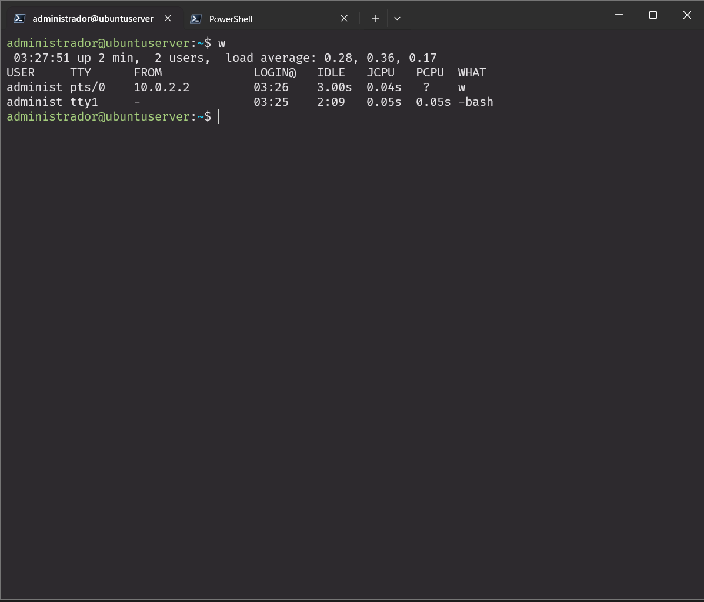

As evidências confirmam que o redirecionamento de portas e o acesso remoto funcionaram corretamente:
- Antes da regra, a porta `5222` não aparecia no `netstat` do Windows. Depois dela, passou a aparecer como `127.0.0.1:5222 ... LISTENING`, ou seja, o VirtualBox começou a escutar essa porta no Host.
- O login com `ssh -p 5222 administrador@127.0.0.1` foi aceito, e a tela de boas-vindas informou o IPv4 `10.0.2.15` da interface `enp0s3`. Isso comprova que a conexão feita no `127.0.0.1:5222` do Host chegou à porta `22` da VM.
- Durante a sessão, o `netstat` exibiu o par de conexões `127.0.0.1:5222 <-> 127.0.0.1:63678` em estado `ESTABLISHED`. Um lado é o VirtualBox, na porta `5222`, e o outro é o cliente SSH do Windows, na porta efêmera `63678`.
- Antes do SSH, o comando `w` listava somente a sessão `tty1`. Na sessão remota, passou a exibir `2 users`: `tty1` (console do VirtualBox) e `pts/0` (pseudo-terminal do SSH), com origem `10.0.2.2`. A origem é o gateway NAT do VirtualBox, e não o IP real do Windows, porque o Host fica "escondido" atrás do NAT.

## 6. Conclusão
A prática mostrou que, no modo NAT, a VM consegue acessar a internet mas não pode ser alcançada diretamente pelo Host, pois o IP `10.0.2.15` pertence a uma rede privada isolada pelo VirtualBox. O Redirecionamento de Portas resolve isso de forma controlada: só a porta escolhida (`5222`) é exposta, e somente em `127.0.0.1`, o que limita o acesso ao próprio Host. Os comandos de auditoria foram essenciais para acompanhar cada etapa. `ifconfig`, `route -n` e `netplan status` mostraram como a VM está endereçada e roteada. O `netstat -an` mostrou a porta passando de inexistente para `LISTENING` e depois para `ESTABLISHED`, e o `w` identificou a sessão remota `pts/0` e sua origem. Entender esse fluxo de portas é fundamental para administrar servidores virtualizados e diagnosticar falhas de acesso remoto, verificando em cada ponto (Host, hipervisor e Guest) onde a conexão está sendo interrompida.
