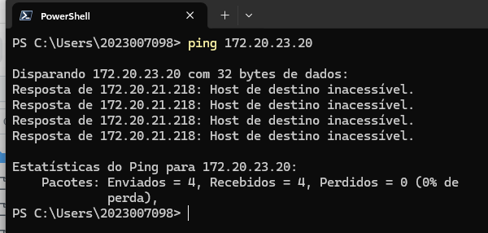
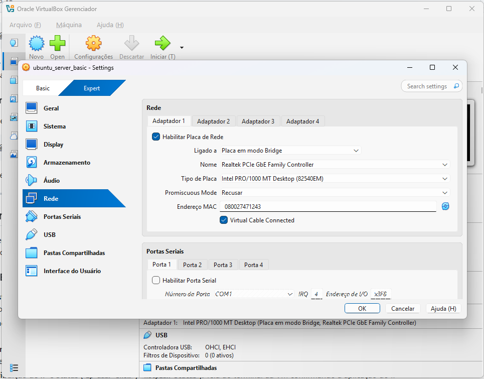
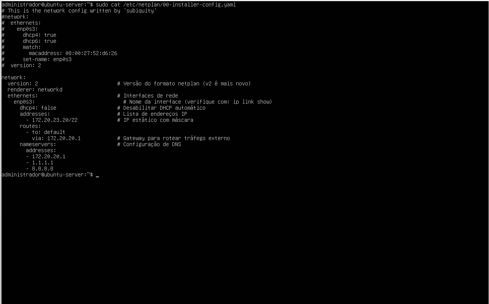
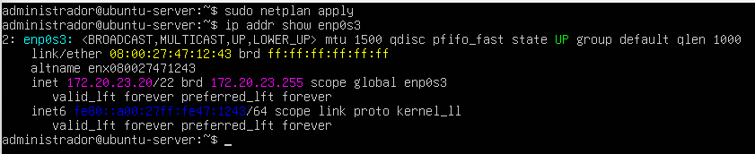
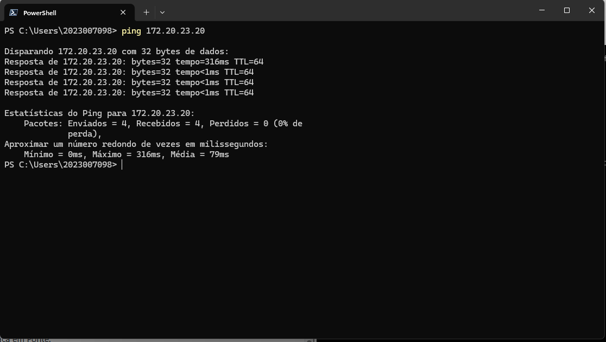
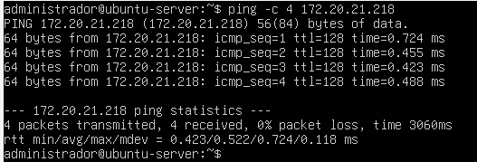
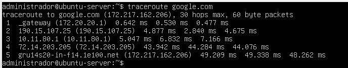
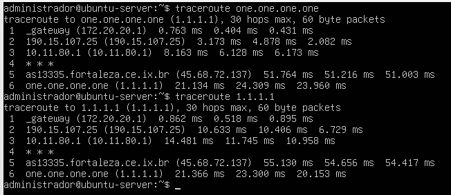

# Relatório Técnico - Aula Prática 06

## 1. Identificação
- Título da prática: Configuração de Rede Estática com Netplan e Modo Placa em Ponte (Bridge Adapter) no VirtualBox
- Aluno: João Pedro de Castro Laranjeira Rocha
- Matrícula: 2023007098
- Turma: LSOR - BSI
- Data da prática: 23/09/2026

## 2. Objetivo
Reconfigurar o adaptador de rede da máquina virtual Ubuntu Server do modo NAT para o modo Placa em Ponte (Bridge Adapter), fazendo com que a VM passe a integrar diretamente a rede física do laboratório (`172.20.20.0/22`), e atribuir a ela um endereço IP estático, gateway e servidores DNS por meio do Netplan, seguindo o padrão da documentação oficial do Ubuntu Server. Por fim, validar a configuração com testes de conectividade bidirecional entre Host e Guest e com o rastreamento de rotas externas via `traceroute`.

## 3. Ambiente
- Host: Windows 11, com placa de rede física Realtek PCIe GbE Family Controller e IP `172.20.21.218`
- Hipervisor: Oracle VirtualBox
- Guest: Ubuntu Server 26.04 LTS (VM `ubuntu_server_basic`, hostname `ubuntu-server`), criada na Aula 1
- Usuário administrativo utilizado: `administrador`
- Adaptador 1 da VM: Intel PRO/1000 MT Desktop (82540EM), em modo Placa em Ponte, cabo virtual conectado
- Interface de rede no Guest: `enp0s3`
- Arquivo de configuração: `/etc/netplan/00-installer-config.yaml`
- Parâmetros de rede aplicados:
  - Endereço IP da VM: `172.20.23.20/22`
  - Máscara de sub-rede: `255.255.252.0` (`/22`)
  - Gateway padrão: `172.20.20.1`
  - Servidores DNS: `172.20.20.1`, `1.1.1.1` e `8.8.8.8`

## 4. Procedimento
1. No PowerShell do Windows (Host), foi executado `ping 172.20.23.20` para verificar se o endereço candidato estava livre. O retorno foi `Host de destino inacessível`, indicando que nenhuma máquina da rede utilizava esse IP.
2. Nas configurações da VM no VirtualBox, em **Rede > Adaptador 1**, a opção **Ligado a** foi alterada de NAT para **Placa em modo Bridge**, selecionando a placa física `Realtek PCIe GbE Family Controller` e mantendo o **Virtual Cable Connected** marcado.
3. Na VM, o arquivo `/etc/netplan/00-installer-config.yaml` foi editado com `sudo nano`. A configuração original gerada pelo instalador (`subiquity`), que utilizava DHCP, foi mantida apenas como comentário, e foi adicionado o novo bloco `network` com:
   - `version: 2` e `renderer: networkd`;
   - `dhcp4: false` na interface `enp0s3`;
   - endereço estático `172.20.23.20/22`;
   - rota padrão (`to: default`) via `172.20.20.1`;
   - servidores DNS `172.20.20.1`, `1.1.1.1` e `8.8.8.8`.
4. O conteúdo do arquivo foi exibido com `sudo cat /etc/netplan/00-installer-config.yaml` para conferir a sintaxe e a indentação do YAML antes da aplicação.
5. A configuração foi aplicada com `sudo netplan apply`.
6. A atribuição do novo endereço foi verificada com `ip addr show enp0s3`, que exibiu a interface em estado `UP` com o IP `172.20.23.20/22`.
7. Foi realizado o ping do Host Windows para a VM (`ping 172.20.23.20`).
8. Foi realizado o ping da VM para o Host Windows (`ping -c 4 172.20.21.218`), utilizando o IP obtido com `ipconfig`.
9. Foi executado `traceroute google.com` para testar a resolução de nomes via DNS e a rota de saída para a internet.
10. Foram executados `traceroute one.one.one.one` e `traceroute 1.1.1.1` para verificar a resolução do nome do DNS da Cloudflare e a rota até o destino.

### Arquivo Netplan aplicado
```yaml
network:
  version: 2
  renderer: networkd
  ethernets:
    enp0s3:
      dhcp4: false
      addresses:
        - 172.20.23.20/22
      routes:
        - to: default
          via: 172.20.20.1
      nameservers:
        addresses:
          - 172.20.20.1
          - 1.1.1.1
          - 8.8.8.8
```

### Comandos principais utilizados
*   **`ping`:** envia pacotes ICMP Echo Request para testar se um host está alcançável; usado tanto para encontrar um IP livre quanto para validar a conectividade.
*   **`nano`:** editor de texto de terminal usado para alterar o arquivo YAML do Netplan.
*   **`cat`:** exibe o conteúdo do arquivo de configuração para conferência.
*   **`netplan apply`:** valida o arquivo YAML e aplica a nova configuração de rede ao sistema.
*   **`ip addr show`:** exibe os endereços atribuídos a uma interface de rede.
*   **`traceroute`:** mostra cada salto (roteador) percorrido pelos pacotes até o destino.
*   **`ipconfig`:** exibe a configuração de rede do Host Windows.

## 5. Testes e Evidências

**Print 1 - Teste de IP livre no Windows Host com ping 172.20.23.20 retornando "Host de destino inacessível"**



**Print 2 - Adaptador 1 da VM configurado como Placa em modo Bridge na placa Realtek PCIe GbE Family Controller**



**Print 3 - Conteúdo do arquivo /etc/netplan/00-installer-config.yaml exibido com cat, com renderer networkd, IP estático, rota padrão e DNS**



**Print 4 - Aplicação com netplan apply e confirmação do IP 172.20.23.20/22 na interface enp0s3 com ip addr show**



**Print 5 - Ping do Windows Host para a VM (172.20.23.20)**



**Print 6 - Ping da VM para o Windows Host (172.20.21.218)**



**Print 7 - Saída do traceroute google.com**



**Print 8 - Saída do traceroute one.one.one.one e traceroute 1.1.1.1**



As evidências confirmam que a configuração foi aplicada com sucesso:
- Antes da configuração, o IP `172.20.23.20` não respondia na rede, comprovando que estava disponível.
- Após o `netplan apply`, a interface `enp0s3` passou a exibir o endereço `172.20.23.20/22` com broadcast `172.20.23.255`, em estado `UP`.
- O ping do Host para a VM obteve 4 respostas com 0% de perda e `TTL=64` (valor padrão de sistemas Linux). A primeira resposta levou 316 ms, pois incluiu a resolução ARP inicial; as seguintes ficaram abaixo de 1 ms.
- O ping da VM para o Host também obteve 4 respostas com 0% de perda e `ttl=128` (valor padrão do Windows), com tempo médio de 0,522 ms, confirmando a comunicação bidirecional na mesma rede local.
- No `traceroute google.com`, o nome foi resolvido para `172.217.162.206`, e o primeiro salto foi o gateway do laboratório (`_gateway`, `172.20.20.1`), seguido pelos roteadores externos até o destino final `gru14s20-in-f14.1e100.net`, em 5 saltos.
- No `traceroute one.one.one.one`, o nome foi resolvido para `1.1.1.1` e a rota novamente partiu do gateway `172.20.20.1`, passando pelo ponto de troca de tráfego `as13335.fortaleza.ce.ix.br` até chegar a `one.one.one.one (1.1.1.1)` no 6º salto. O `traceroute 1.1.1.1` apresentou a mesma rota, confirmando a correspondência entre o nome e o IP.

## 6. Problemas e Soluções
- Sem problemas para essa etapa. Foram observados apenas dois pontos que merecem registro:
  - No teste de IP livre (Print 1), o Windows exibiu `Recebidos = 4` e `0% de perda`, mas as respostas vieram do próprio Host (`172.20.21.218`) com a mensagem `Host de destino inacessível`. Ou seja, nenhuma máquina respondeu no endereço `172.20.23.20`, e o IP estava de fato livre.
  - No `traceroute` para a Cloudflare (Print 8), o 4º salto exibiu `* * *`. Isso ocorre quando um roteador intermediário não responde às sondas do `traceroute` (por política de filtragem), sem impedir que os pacotes sigam até o destino, que foi alcançado normalmente.

## 7. Conclusão
A prática mostrou na prática a diferença entre os modos NAT e Placa em Ponte do VirtualBox: com o modo Bridge, a VM deixou de ficar isolada atrás do roteador virtual do hipervisor e passou a se comportar como um computador independente na rede do laboratório, acessível diretamente pelo Host e pelas demais máquinas, sem necessidade de redirecionamento de portas. A configuração de IP estático via Netplan garante que o servidor mantenha sempre o mesmo endereço, característica essencial para serviços que precisam ser localizados de forma previsível (como servidores web, DNS ou de arquivos). Em contrapartida, esse modelo exige cuidados: é preciso verificar previamente se o IP está livre para evitar conflitos, respeitar rigorosamente a sintaxe e a indentação do YAML e definir corretamente gateway e DNS, sem os quais o servidor fica sem acesso externo ou sem resolução de nomes. Em ambientes corporativos, também é recomendável documentar e reservar esses endereços fora da faixa do DHCP.
