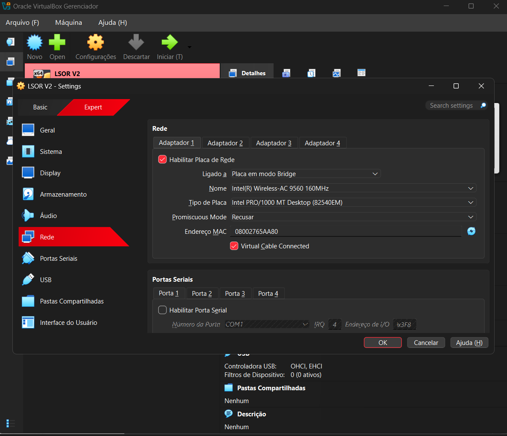
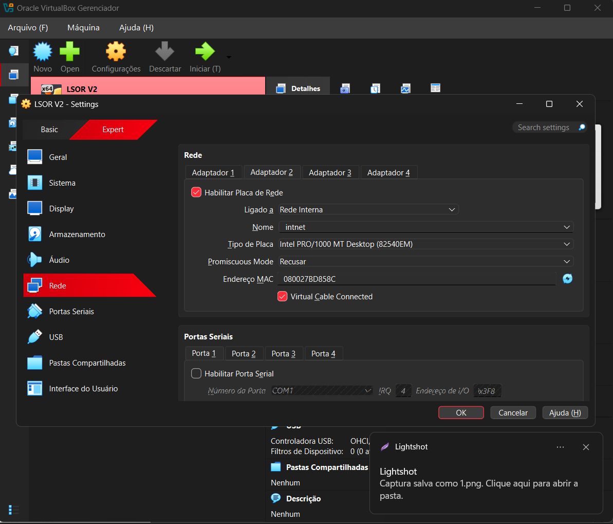
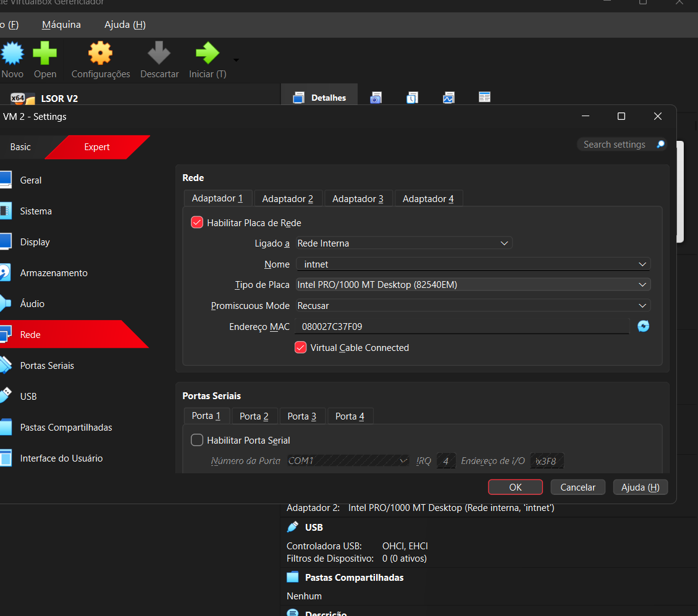
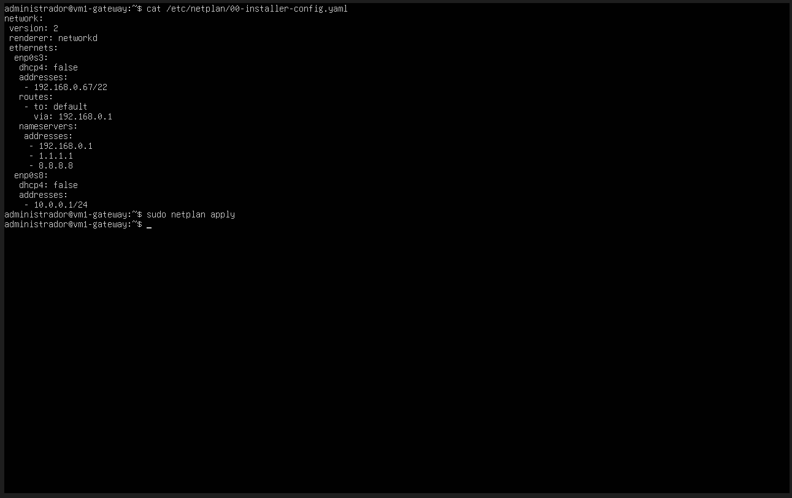
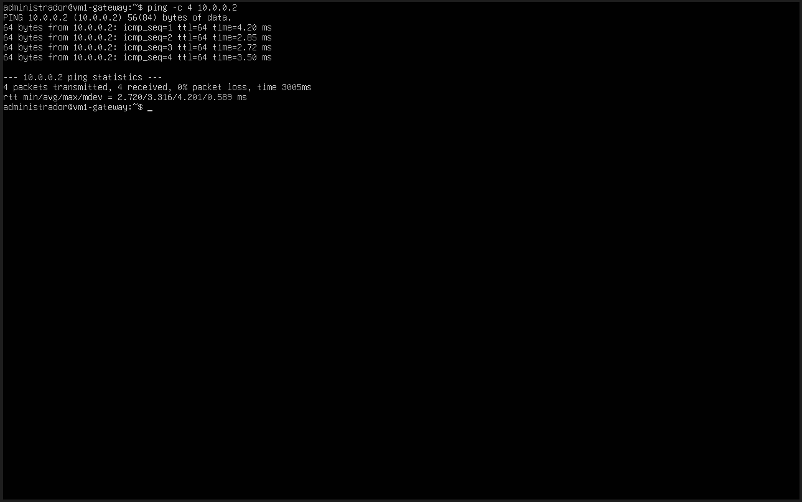
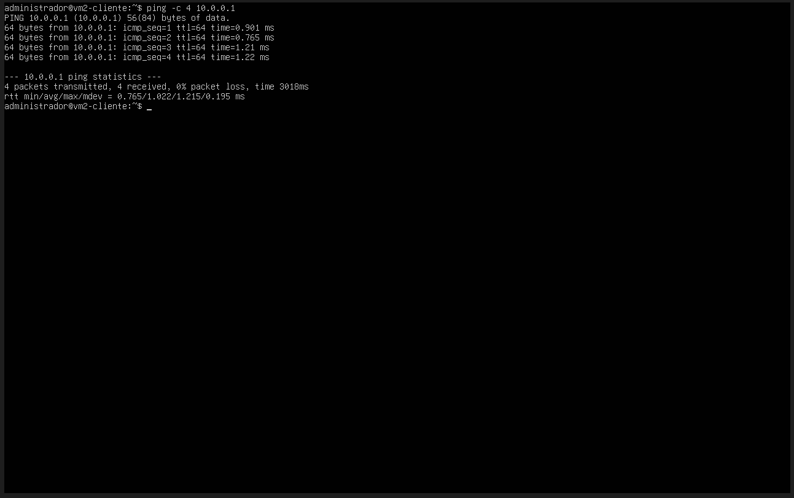

# Relatório Técnico - Aula Prática 07

## 1. Identificação
- Título da prática: Roteamento e Gateway NAT com IPTables e Rede Interna no VirtualBox
- Aluno: João Pedro de Castro Laranjeira Rocha
- Matrícula: 2023007098
- Turma: LSOR - BSI
- Data da prática: 07/10/2026 (prints de Netplan e ping refeitas em 14/10/2026)

## 2. Objetivo
Montar a topologia de um gateway Linux com duas máquinas virtuais: a VM1 atua como roteador, com uma interface voltada para a rede externa (Bridge) e outra para uma rede interna isolada do VirtualBox; a VM2 é um cliente que só enxerga a rede interna e usa a VM1 como gateway padrão. Nesta etapa o foco é a configuração das placas no VirtualBox, o endereçamento via Netplan e a conectividade dentro da rede interna. A tradução de endereços (NAT/mascaramento) com IPTables, que permite à VM2 alcançar a internet, é concluída na Aula 08.

## 3. Ambiente
- Host: notebook Windows conectado à rede doméstica por Wi-Fi (placa `Intel(R) Wireless-AC 9560 160MHz`)
- Hipervisor: Oracle VirtualBox
- Sistema operacional das VMs: Ubuntu Server 26.04 LTS
- Usuário administrativo utilizado: `administrador`

| VM (VirtualBox) | Hostname | Adaptador | Modo | Interface | Endereço |
| :--- | :--- | :--- | :--- | :--- | :--- |
| `LSOR V2` (VM1) | `vm1-gateway` | Adaptador 1 (WAN) | Placa em modo Bridge (Intel Wireless-AC 9560) | `enp0s3` | `192.168.0.67/22` |
| `LSOR V2` (VM1) | `vm1-gateway` | Adaptador 2 (LAN) | Rede Interna `intnet` | `enp0s8` | `10.0.0.1/24` |
| `VM 2` (VM2) | `vm2-cliente` | Adaptador 1 (LAN) | Rede Interna `intnet` | `enp0s3` | `10.0.0.2/24` |

Os hostnames `vm1-gateway` e `vm2-cliente` que aparecem nas prints foram definidos na Aula 08, já que as prints de Netplan e ping foram refeitas depois dela.

### Adaptações em relação ao roteiro
A prática foi realizada fora do IFAL, então a rede externa do roteiro (`172.20.20.0/22`) não existia no ambiente. Os parâmetros da WAN foram trocados pelos da rede doméstica; a rede interna permaneceu igual.

| Parâmetro | Roteiro (rede do IFAL) | Utilizado (rede doméstica) |
| :--- | :--- | :--- |
| Placa física da Bridge | Placa cabeada do laboratório | `Intel(R) Wireless-AC 9560` (Wi-Fi) |
| IP da VM1 (`enp0s3`) | `172.20.23.X/22` | `192.168.0.67/22` |
| Gateway externo | `172.20.20.1` | `192.168.0.1` (roteador doméstico) |
| DNS | `172.20.20.1`, `1.1.1.1`, `8.8.8.8` | `192.168.0.1`, `1.1.1.1`, `8.8.8.8` |
| Rede interna (LAN) | `10.0.0.0/24` | `10.0.0.0/24` (sem alteração) |

## 4. Procedimento
1. Na VM1 (`LSOR V2`), em **Configurações -> Rede**, o **Adaptador 1** foi configurado como **Placa em modo Bridge**, ligado à placa Wi-Fi do notebook.
2. Ainda na VM1, o **Adaptador 2** foi habilitado no modo **Rede Interna**, com o nome `intnet`.
3. Na VM2 (`VM 2`), o **Adaptador 1** foi configurado como **Rede Interna** com o mesmo nome `intnet`, para que as duas VMs fiquem no mesmo segmento isolado.
4. Na VM1, o arquivo `/etc/netplan/00-installer-config.yaml` foi editado com as duas interfaces: `enp0s3` com IP estático, rota padrão e DNS da rede doméstica, e `enp0s8` apenas com o IP `10.0.0.1/24` (sem rota padrão, pois é a interface da LAN):

```yaml
network:
 version: 2
 renderer: networkd
 ethernets:
  enp0s3:
   dhcp4: false
   addresses:
    - 192.168.0.67/22
   routes:
    - to: default
      via: 192.168.0.1
   nameservers:
    addresses:
     - 192.168.0.1
     - 1.1.1.1
     - 8.8.8.8
  enp0s8:
   dhcp4: false
   addresses:
    - 10.0.0.1/24
```

5. A configuração da VM1 foi aplicada com `sudo netplan apply`.
6. Na VM2, o arquivo Netplan foi editado com o IP `10.0.0.2/24`. A rota padrão via `10.0.0.1` (VM1) já foi incluída nesta etapa, adiantando o que o roteiro da Aula 08 pede:

```yaml
network:
 version: 2
 renderer: networkd
 ethernets:
  enp0s3:
   dhcp4: false
   addresses:
    - 10.0.0.2/24
   routes:
    - to: default
      via: 10.0.0.1
   nameservers:
    addresses:
     - 192.168.0.1
     - 1.1.1.1
     - 8.8.8.8
```

7. A configuração da VM2 foi aplicada com `sudo netplan apply`.
8. Foram executados os pings entre as VMs pela rede interna: da VM1 para `10.0.0.2` e da VM2 para `10.0.0.1`.

## 5. Testes e Evidências

**Print 1 - VM1: Adaptador 1 em Placa em modo Bridge (Intel Wireless-AC 9560)**



**Print 2 - VM1: Adaptador 2 em Rede Interna (intnet)**



**Print 3 - VM2: Adaptador 1 em Rede Interna (intnet)**



**Print 4 - VM1: conteúdo do Netplan com enp0s3 (192.168.0.67) e enp0s8 (10.0.0.1) e aplicação com netplan apply**



**Print 5 - VM2: conteúdo do Netplan com enp0s3 (10.0.0.2) e gateway 10.0.0.1 e aplicação com netplan apply**


**Print 6 - Ping da VM1 para a VM2 (10.0.0.2)**



**Print 7 - Ping da VM2 para a VM1 (10.0.0.1)**



Os pings nos dois sentidos tiveram 0% de perda, comprovando que as duas VMs estão no mesmo segmento `intnet` e que os endereços da rede `10.0.0.0/24` foram aplicados corretamente. Como o roteiro antecipa, o ping da VM2 para o gateway externo e o `traceroute` para a internet ainda não funcionam nesta etapa, porque a VM1 ainda não faz encaminhamento nem NAT; esses testes foram realizados na Aula 08.

## 6. Problemas e Soluções
- **Prática fora da rede do IFAL:** os endereços do roteiro (`172.20.20.0/22`, gateway `172.20.20.1`) só existem na rede do laboratório. A configuração inicial seguiu esses valores, mas em casa a VM1 não tinha como alcançar esse gateway. **Solução:** a interface WAN da VM1 foi reconfigurada para a rede doméstica (`192.168.0.67`, gateway e DNS `192.168.0.1`), o DNS da VM2 foi ajustado da mesma forma, e as prints de Netplan e ping (4 a 7) foram refeitas com a configuração final.
- **Bridge sobre Wi-Fi:** o notebook não usa cabo, então a Bridge foi feita sobre a placa Wi-Fi. O VirtualBox suporta esse modo para IPv4, e funcionou neste ambiente, mas alguns roteadores sem fio podem bloquear o tráfego de uma VM em bridge. Nesses casos, a alternativa é usar o Adaptador 1 da VM1 em modo NAT, mantendo o restante da topologia.
- **Máscara de sub-rede:** a máscara `/22` da rede do IFAL foi mantida no IP `192.168.0.67`. Como o roteador `192.168.0.1` está dentro dessa faixa, a comunicação funcionou, mas o correto é usar a máscara real da rede doméstica (normalmente `/24`), conferida com `ipconfig` no Windows.

## 7. Conclusão
A prática mostrou como montar, apenas com o VirtualBox, uma topologia típica de rede corporativa: um servidor com duas interfaces separando a rede externa de uma rede interna privada. A Rede Interna do VirtualBox isola a VM2, que só se comunica com a VM1; por isso o gateway é o único caminho para fora, e é nele que se concentra o controle do tráfego. A necessidade de adaptar os IPs para a rede doméstica também reforçou que a configuração da WAN depende sempre da rede física onde o servidor está conectado, enquanto a rede interna pode ser mantida igual em qualquer ambiente.
