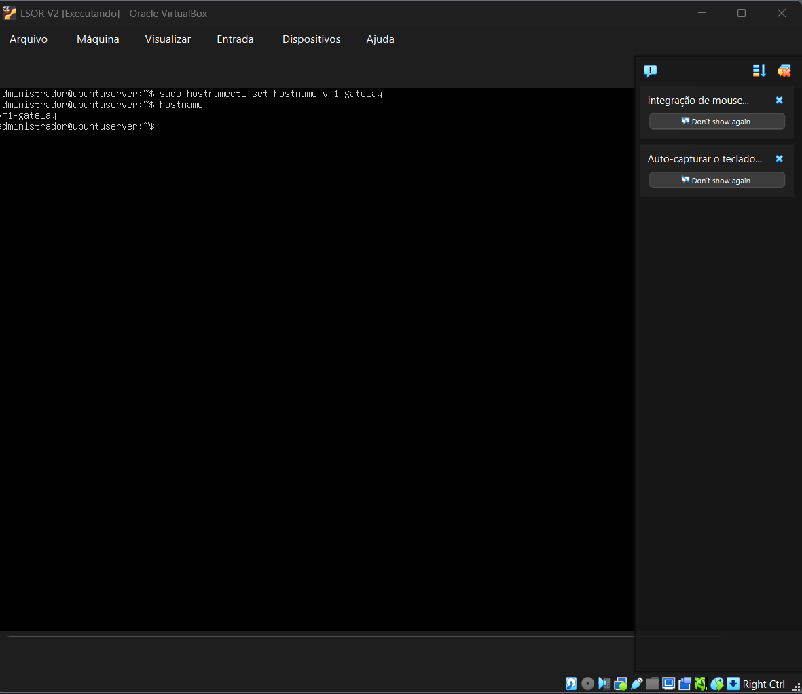
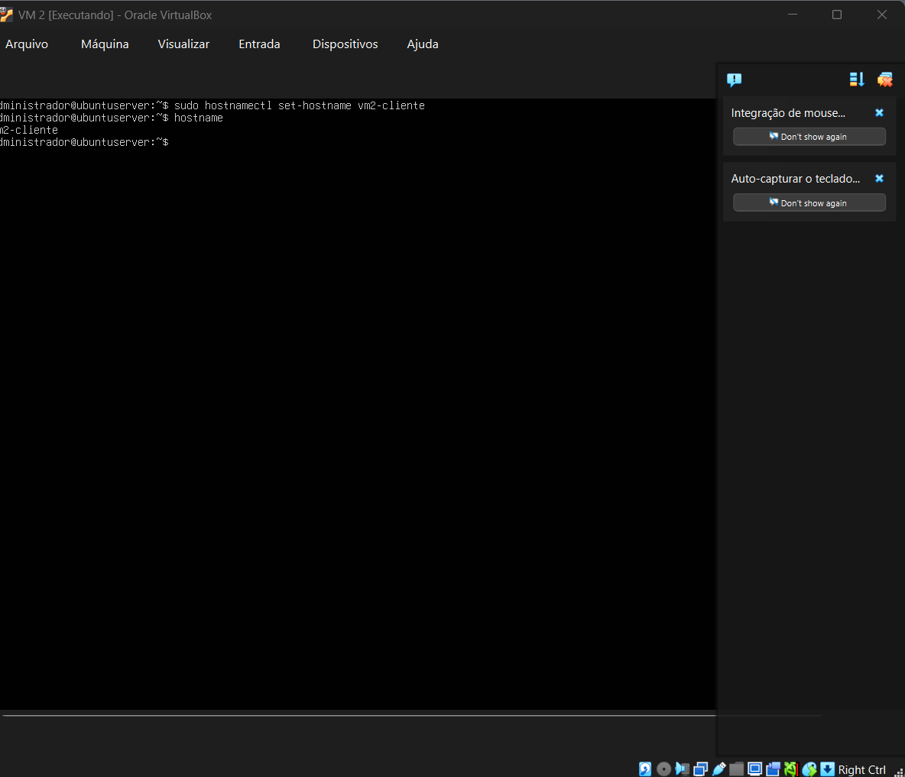
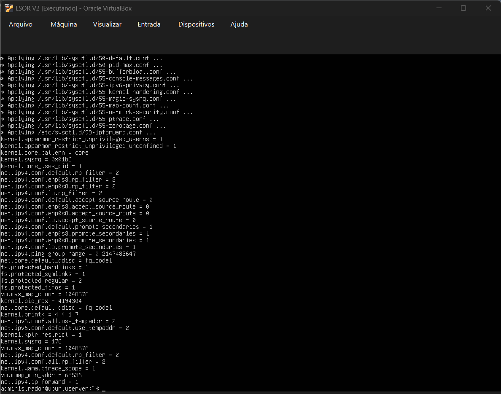
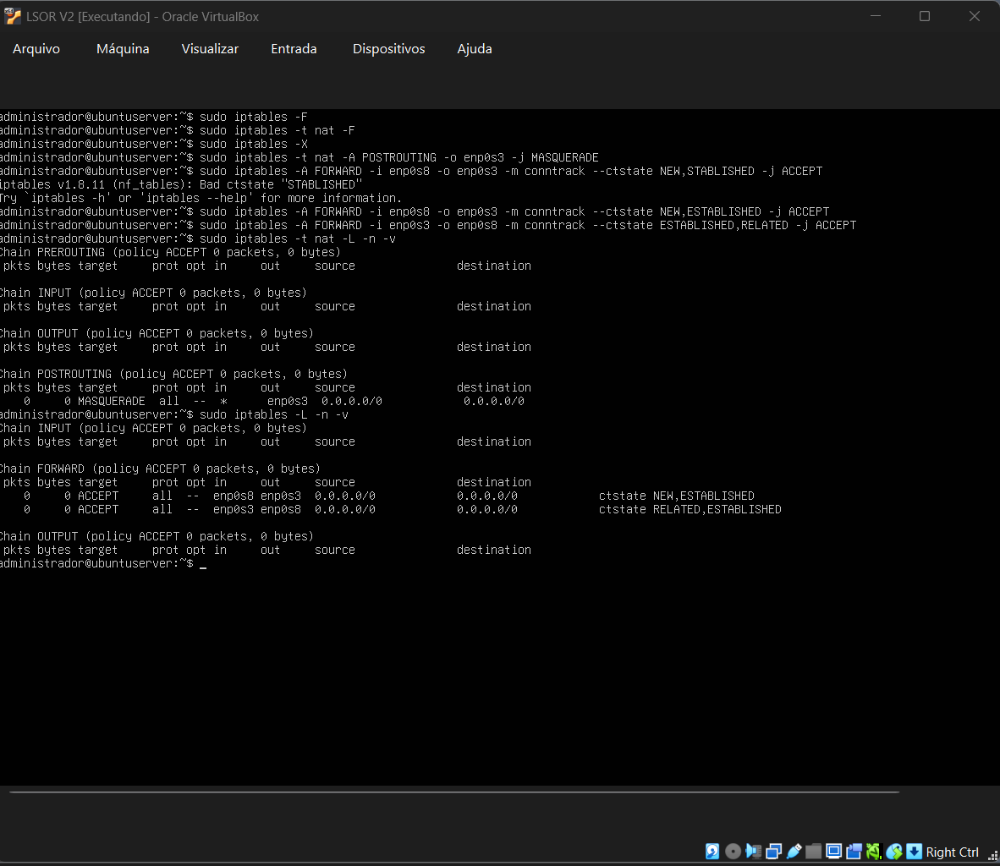
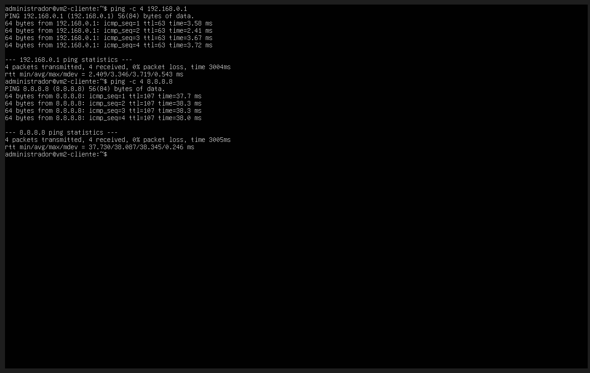
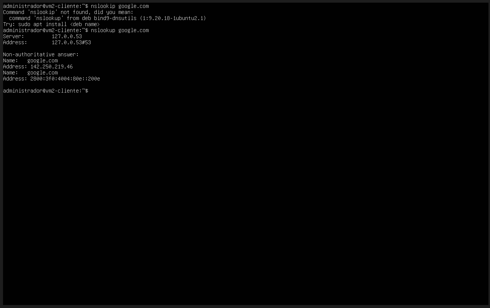
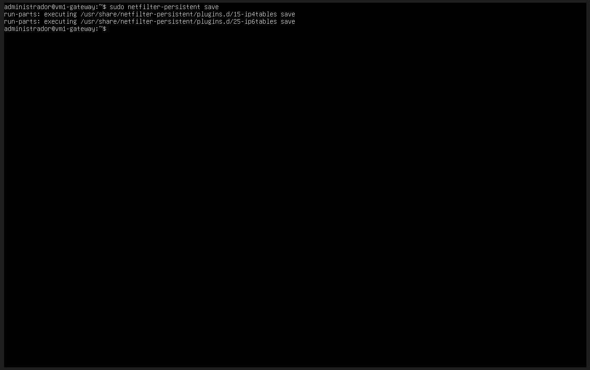
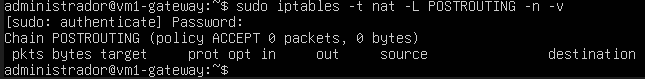

# Relatório Técnico - Aula Prática 08

## 1. Identificação
- Título da prática: Configuração do Gateway (VM1) — IPTables, NAT e Testes
- Aluno: João Pedro de Castro Laranjeira Rocha
- Matrícula: 2023007098
- Turma: LSOR - BSI
- Data da prática: 07/10/2026 e 14/10/2026

## 2. Objetivo
Concluir o gateway iniciado na Aula 07: habilitar o encaminhamento de pacotes IPv4 na VM1, aplicar o mascaramento (NAT) com IPTables para que os pacotes da rede interna saiam com o IP externo do gateway, tornar as regras persistentes e validar, a partir da VM2, o acesso à rede externa, à internet e a resolução de nomes.

## 3. Ambiente
- Host: notebook Windows conectado à rede doméstica por Wi-Fi
- Hipervisor: Oracle VirtualBox
- Sistema operacional das VMs: Ubuntu Server 26.04 LTS
- Usuário administrativo utilizado: `administrador`
- Topologia: a mesma da Aula 07

| VM | Hostname | Interface | Rede | Endereço |
| :--- | :--- | :--- | :--- | :--- |
| VM1 (gateway) | `vm1-gateway` | `enp0s3` (WAN, Bridge Wi-Fi) | Rede doméstica | `192.168.0.67`, gateway `192.168.0.1` |
| VM1 (gateway) | `vm1-gateway` | `enp0s8` (LAN, `intnet`) | Rede interna | `10.0.0.1/24` |
| VM2 (cliente) | `vm2-cliente` | `enp0s3` (LAN, `intnet`) | Rede interna | `10.0.0.2/24`, gateway `10.0.0.1` |

### Adaptações em relação ao roteiro
Como na Aula 07, a prática foi feita fora do IFAL, e os endereços da rede do laboratório foram substituídos pelos da rede doméstica:

| Item | Roteiro (rede do IFAL) | Utilizado (rede doméstica) |
| :--- | :--- | :--- |
| Gateway externo (próximo salto da VM1) | `172.20.20.1` | `192.168.0.1` |
| DNS da VM2 | `172.20.20.1`, `1.1.1.1`, `8.8.8.8` | `192.168.0.1`, `1.1.1.1`, `8.8.8.8` |
| Ping de teste da rede externa | `ping 172.20.20.1` | `ping 192.168.0.1` |
| Ping de teste da internet | `ping 1.1.1.1` | `ping 8.8.8.8` |

## 4. Procedimento
1. **Hostnames:** com `hostnamectl`, as VMs foram renomeadas para `vm1-gateway` e `vm2-cliente`, conferindo o resultado com `hostname`.
2. **Encaminhamento de IP (VM1):** o roteamento entre interfaces foi habilitado de forma persistente, gravando o parâmetro em um arquivo do `sysctl.d` e recarregando as configurações:

```bash
echo "net.ipv4.ip_forward=1" | sudo tee /etc/sysctl.d/99-ipforward.conf
sudo sysctl --system
```

3. **Regras IPTables (VM1):** as regras antigas foram limpas e foram criadas a regra de mascaramento na saída para a WAN e as regras de encaminhamento entre LAN e WAN:

```bash
sudo iptables -F
sudo iptables -t nat -F
sudo iptables -X
sudo iptables -t nat -A POSTROUTING -o enp0s3 -j MASQUERADE
sudo iptables -A FORWARD -i enp0s8 -o enp0s3 -m conntrack --ctstate NEW,ESTABLISHED -j ACCEPT
sudo iptables -A FORWARD -i enp0s3 -o enp0s8 -m conntrack --ctstate ESTABLISHED,RELATED -j ACCEPT
```

4. As regras foram conferidas com `sudo iptables -t nat -L -n -v` e `sudo iptables -L -n -v`.
5. **Netplan da VM2:** foi confirmada a rota padrão via `10.0.0.1`, para que todo tráfego fora da rede interna seja entregue à VM1. No arquivo utilizado, a chave `routes` está no mesmo nível de `addresses` e `nameservers`; no roteiro ela aparece desalinhada, e o YAML seria rejeitado pelo `netplan`.
6. **Testes na VM2:** `ping` para o roteador doméstico (`192.168.0.1`) e para a internet (`8.8.8.8`), e `nslookup google.com` para testar o DNS.
7. **Persistência (VM1):** foi instalado o pacote `iptables-persistent` e as regras foram salvas, ficando gravadas em `/etc/iptables/rules.v4` e sendo restauradas automaticamente na inicialização:

```bash
sudo apt install iptables-persistent
sudo netfilter-persistent save
```

### Comandos principais utilizados
*   **`hostnamectl set-hostname`:** altera o nome da máquina exibido no prompt.
*   **`sysctl`:** lê e altera parâmetros do kernel; `net.ipv4.ip_forward=1` permite que o Linux encaminhe pacotes entre interfaces, funcionando como roteador.
*   **`iptables -t nat ... -j MASQUERADE`:** troca o IP de origem dos pacotes que saem pela WAN pelo IP da própria VM1.
*   **`iptables -A FORWARD ... -m conntrack`:** controla quais pacotes podem atravessar o gateway, usando o estado da conexão (nova, estabelecida ou relacionada).
*   **`nslookup`:** consulta o DNS e mostra o endereço associado a um nome.
*   **`netfilter-persistent save`:** grava as regras atuais do IPTables em arquivo para que sobrevivam a reinicializações.

## 5. Testes e Evidências

**Print 1 - Definição do hostname vm1-gateway na VM1**



**Print 2 - Definição do hostname vm2-cliente na VM2**



**Print 3 - Aplicação do sysctl --system com o arquivo 99-ipforward.conf e net.ipv4.ip_forward = 1**



**Print 4 - Limpeza e criação das regras de NAT (MASQUERADE) e FORWARD e listagem das tabelas nat e filter**



**Print 5 - Netplan da VM2 com rota padrão via 10.0.0.1**


**Print 6 - Ping da VM2 para o roteador doméstico (192.168.0.1) e para a internet (8.8.8.8)**



**Print 7 - Resolução de nomes com nslookup google.com na VM2**



**Print 8 - Persistência das regras com netfilter-persistent save na VM1**



Com o NAT ativo, a VM2, que só possui endereço na rede interna, passou a alcançar o roteador doméstico e a internet com 0% de perda. O TTL de `63` nas respostas de `192.168.0.1` (que responde com 64) mostra que o pacote passou por exatamente um roteador no caminho, a VM1. O `nslookup` respondeu pelo `127.0.0.53`, que é o resolvedor local do `systemd-resolved`; ele encaminha a consulta aos servidores definidos no Netplan e retornou os endereços IPv4 e IPv6 de `google.com`.

## 6. Problemas e Soluções
- **Erro de digitação no estado do conntrack:** a primeira regra de FORWARD foi digitada com `STABLISHED`, e o IPTables recusou com `Bad ctstate "STABLISHED"`. **Solução:** o comando foi repetido com `ESTABLISHED` (Print 4).
- **Erro de digitação no nslookup:** o primeiro comando foi digitado como `nslookip`, e o sistema respondeu `command not found`. **Solução:** o comando foi repetido corretamente (Print 7).
- **Mudança de rede (IFAL -> rede doméstica):** a prática foi realizada fora do IFAL, então os IPs `172.20.x.x` do roteiro não funcionavam. **Solução:** a WAN da VM1 foi reconfigurada para `192.168.0.67` com gateway `192.168.0.1`, o DNS da VM2 passou a usar `192.168.0.1`, e os testes de ping foram feitos para `192.168.0.1` e `8.8.8.8` em vez de `172.20.20.1` e `1.1.1.1` (detalhes no relatório da Aula 07).

### Regras do IPTables perdidas após reiniciar a VM1
As regras de NAT foram criadas em 07/10 (Print 4). Em 14/10, depois de trocar os IPs para a rede doméstica, a VM2 pingava a VM1 (`10.0.0.1`), mas não alcançava `192.168.0.1` nem `8.8.8.8`. A primeira suspeita foi a própria troca de IP, mas a consulta à tabela NAT na VM1 mostrou que a cadeia `POSTROUTING` estava vazia:

**Print extra - Cadeia POSTROUTING vazia em 14/10: a regra MASQUERADE havia sumido**



**Causa:** regras criadas com o comando `iptables` ficam apenas na memória do kernel e são apagadas quando a máquina é desligada. Entre 07/10 e 14/10 a VM1 foi desligada, então o MASQUERADE se perdeu. Já o `ip_forward` continuou ativo, porque tinha sido gravado em `/etc/sysctl.d/99-ipforward.conf`. Isso gerou a confusão: a VM1 continuava encaminhando os pacotes da VM2, mas sem trocar o IP de origem. Os pacotes chegavam ao roteador doméstico com origem `10.0.0.2`, e como o roteador não conhece a rede `10.0.0.0/24`, a resposta nunca voltava. Por isso o ping para a VM1 funcionava e todo o resto falhava.

**Solução:** as regras da seção 2 do roteiro foram recriadas, e os pings da VM2 passaram a funcionar (Print 6). Para que o problema não se repita, as regras foram salvas com `iptables-persistent` e `netfilter-persistent save` (Print 8), e agora são restauradas a partir de `/etc/iptables/rules.v4` a cada inicialização.

## 7. Conclusão
Com o encaminhamento de IP e o mascaramento, a VM1 passou a funcionar como um roteador NAT completo: a VM2, isolada na rede interna e sem nenhum endereço da rede externa, consegue acessar a internet usando o IP da VM1. Esse é o mesmo mecanismo dos roteadores domésticos e corporativos, que permitem que vários dispositivos com IPs privados compartilhem um único endereço externo, além de esconder a estrutura da rede interna. O problema com as regras perdidas mostrou, na prática, que a persistência não é um passo opcional: configurações aplicadas só em memória funcionam até a primeira reinicialização, e em um servidor real isso derrubaria o acesso de toda a rede interna sem nenhuma alteração aparente no sistema.
